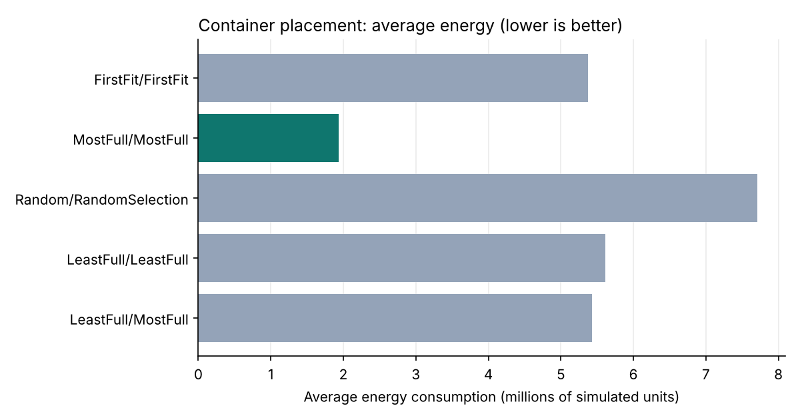
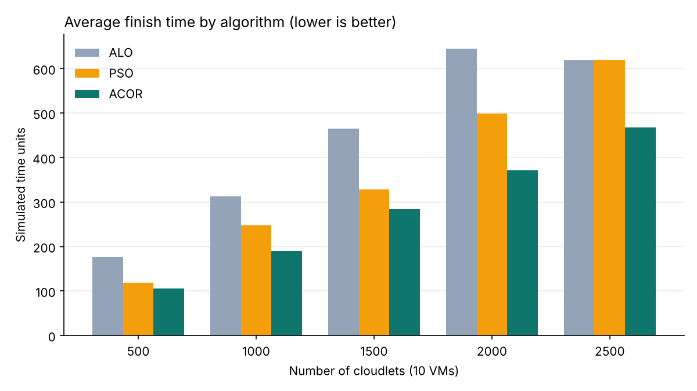
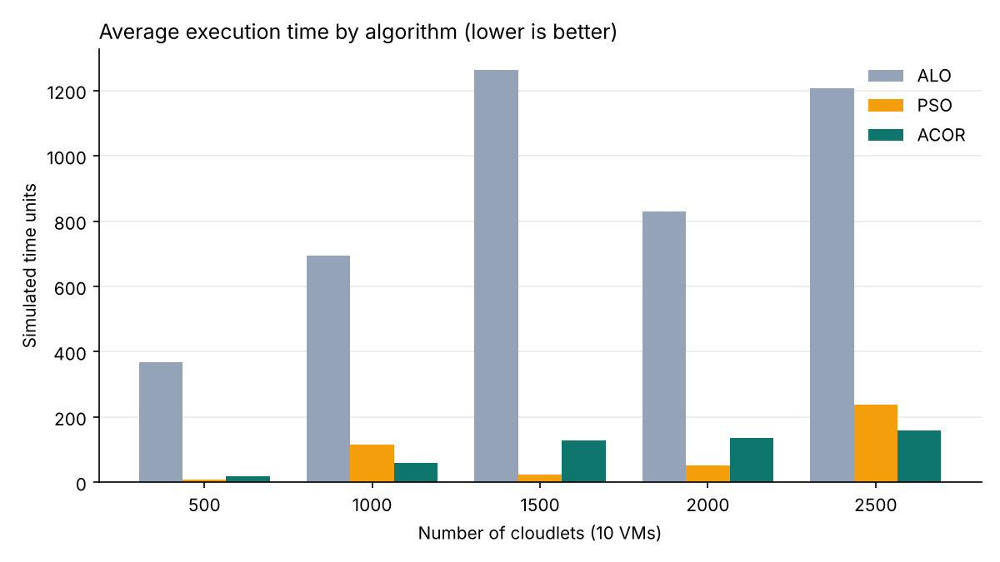

# Metaheuristic Container & VM Scheduling in CloudSim

MSc Cloud Computing research project — National College of Ireland (2023/24)
Supervisor: Dr. Punit Gupta

**Research question:** How can scheduling algorithms reduce the execution time of extended workloads in a containerised cloud environment, and improve the application's overall quality of service?

---

## Overview

Containers are usually placed on virtual machines (VMs), which in turn run on physical machines (PMs). Poor placement at either level wastes energy, triggers unnecessary container migrations and slows applications down.

This project uses a **two-level scheduling approach** and evaluates it in the CloudSim 4.0 simulator:

1. **Containers → VMs:** compare CloudSim's built-in container allocation and host selection policies (FirstFit, LeastFull, MostFull, Random) on container migration time and energy consumption.
2. **VMs → PMs:** compare three nature-inspired metaheuristic algorithms — **ALO** (Ant Lion Optimisation), **PSO** (Particle Swarm Optimisation) and **ACOR** (Revised Ant Colony Optimisation) — on wait, start, finish and execution time as the workload grows.

```
Containers ──► container allocation + host selection policies ──► VMs ──► ACOR / PSO / ALO ──► Physical machines
```

## Tech stack

| Area | Tools |
|---|---|
| Simulation | CloudSim 4.0, ContainerCloudSim, PlanetLab workload traces |
| Container placement | Java (Eclipse IDE, Maven) |
| Metaheuristics | Python, [mealpy](https://github.com/thieu1995/mealpy) (ACOR, ALO, PSO) |
| Concepts | Container orchestration, Kubernetes scheduling, hybrid virtualisation |

## Experiment setup

- 4 data centres, 2 hosts each
- 10 VMs, workload scaled from **500 to 2,500 cloudlets**
- Task lengths: 500 (small), 1,000–2,000 (medium), 4,000 (high)
- Input/output file size: 300 bytes
- Fitness function: execution time

## Results

### Experiment 1 — Container placement (containers → VMs)

The **MostFull container allocation + MostFull host selection** combination performed best on both measures:

| Combination (allocation / host selection) | Avg migration time | Avg energy |
|---|---|---|
| **MostFull / MostFull** | **8,550** | **1.94 M** |
| FirstFit / FirstFit | 43,200 | 5.37 M |
| LeastFull / LeastFull | 43,200 | 5.61 M |
| LeastFull / MostFull | 43,200 | 5.43 M |
| Random / RandomSelection | 43,200 | 7.71 M |

That is roughly **80% lower average migration time** and **64% lower average energy** than the FirstFit baseline.



### Experiment 2 — Metaheuristic VM scheduling (VMs → PMs)

- **ACOR** had the lowest average **start time** and **finish time** at every workload size (e.g. at 2,000 cloudlets: ACOR 371 vs PSO 498 vs ALO 645 finish time).
- **Execution time** was mixed: PSO was lowest at 500, 1,500 and 2,000 cloudlets; ACOR was lowest at 1,000 and 2,500 (the largest load).
- **ALO** had the lowest wait time up to 2,000 cloudlets but the highest execution time throughout.




More charts: [start time](results/start-time-comparison.png) · [wait time](results/wait-time-comparison.png)
Raw data: [vm-scheduling-results.csv](results/vm-scheduling-results.csv) · [container-placement-results.csv](results/container-placement-results.csv)

## Conclusion

Combining **MostFull container placement** with a metaheuristic VM scheduler gives the best overall outcome: lower migration time and energy at the container level, and consistently lower start and finish times with **ACOR**, which also held up best at the largest workload. PSO remains competitive on raw execution time at mid-sized loads.

**Future work:** test the MostFull + ACOR combination on a real container service (AWS ECS/EKS or Google GKE), and measure cost, security and scalability metrics alongside execution time.

## How to run

**Prerequisites:** Java (JDK 8+), Eclipse IDE, Maven, Python 3 with `mealpy`, and [CloudSim 4.0](https://github.com/Cloudslab/cloudsim/releases/tag/cloudsim-4.0).

**Experiment 1 — container placement**
1. Import CloudSim 4.0 into Eclipse as a Maven project.
2. Copy the files from `src/` into the ContainerCloudSim examples package:
   - `NaseemsContainerCloudSimExample.java`, `NaseemsConstants.java`, `NaseemsContainerInitialPlacementTest.java` → next to `ContainerCloudSimExample1.java`
   - `NaseemsContainerPlacementPolicy.java` → next to `ContainerPlacementPolicyMostFull.java`
3. Set the policy combination in `NaseemsConstants.java`.
4. Run `NaseemsContainerCloudSimExample.java` and read migration and energy figures from the output folder.

**Experiment 2 — metaheuristic VM scheduling**
1. Run `CloudSimExample6.java` with the chosen number of cloudlets; it writes `data.json`.
2. Run the ACOR / PSO / ALO script (mealpy) on `data.json`; it writes `sample.json`.
3. Resume `CloudSimExample6.java`, which reads `sample.json` and prints wait, start and finish times per cloudlet.

## Repository structure

```
├── src/        Java source files written for this project
├── results/    Charts and CSV data from the experiments
└── README.md
```

This repository contains only the files written for this project. CloudSim itself is © the CLOUDS Laboratory, University of Melbourne, and must be downloaded separately.

## References

- Piraghaj et al. (2017). *ContainerCloudSim: An environment for modeling and simulation of containers in cloud data centers.* Software: Practice and Experience 47(4).
- Dorigo, Birattari & Stützle (2006). *Ant colony optimization.* IEEE Computational Intelligence Magazine 1(4).
- Shekar (2019). *Improving Kubernetes container scheduling using ant colony optimization.*
- Kaewkasi & Chuenmuneewong (2017). *Improvement of container scheduling for Docker using ant colony optimization.*
